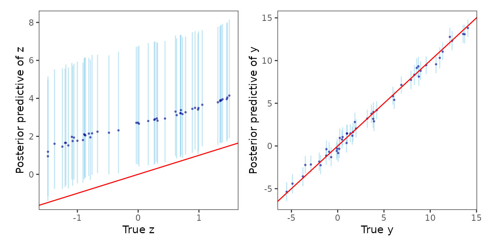
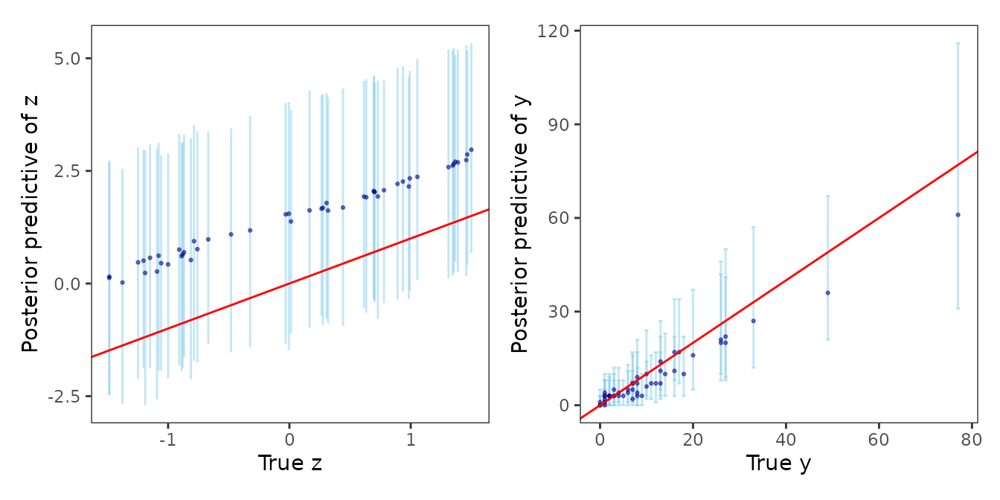
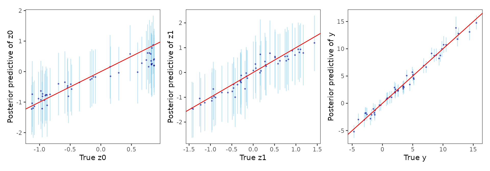
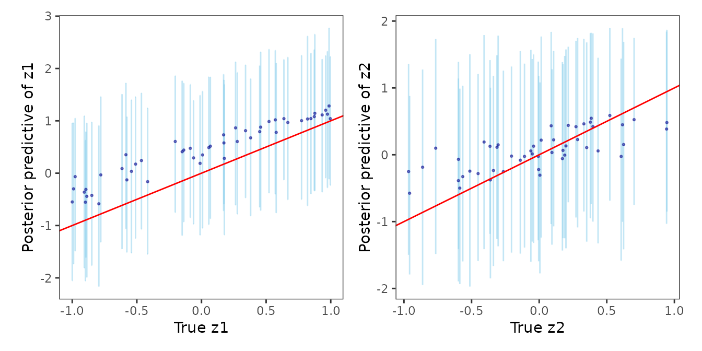

# Posterior Predictive Inference

In this article, we discuss the function -

- [`posteriorPredict()`](https://span-18.github.io/spStack-dev/reference/posteriorPredict.md)

This function can be used to obtain posterior predictive inference at
unobserved locations in space or time. It is applied on the output of
functions
[`spLMexact()`](https://span-18.github.io/spStack-dev/reference/spLMexact.md),
[`spLMstack()`](https://span-18.github.io/spStack-dev/reference/spLMstack.md),
[`spGLMexact()`](https://span-18.github.io/spStack-dev/reference/spGLMexact.md),
[`spGLMstack()`](https://span-18.github.io/spStack-dev/reference/spGLMstack.md),
[`stvcLMexact()`](https://span-18.github.io/spStack-dev/reference/stvcLMexact.md),
[`stvcLMstack()`](https://span-18.github.io/spStack-dev/reference/stvcLMstack.md),
[`stvcGLMexact()`](https://span-18.github.io/spStack-dev/reference/stvcGLMexact.md)
and
[`stvcGLMstack()`](https://span-18.github.io/spStack-dev/reference/stvcGLMstack.md).
We use the synthetic datasets `simSpatial` and `simSpaceTime`: we fit
the models on the first rows of a dataset and predict at the next ones,
where we compare the predictions with the true values.

``` r

library(spStack)
library(ggplot2)
library(patchwork)
set.seed(1729)
```

The `joint` argument in
[`posteriorPredict()`](https://span-18.github.io/spStack-dev/reference/posteriorPredict.md)
indicates if the predictions at the new locations or times are to be
made based on the joint posterior predictive distribution or not. If
`joint=FALSE`, then the individual predictions are made from their
corresponding posterior predictive distributions.

## Prediction in spatial linear model

Define the collection of candidate models and fit using
[`spLMstack()`](https://span-18.github.io/spStack-dev/reference/spLMstack.md)
to the Gaussian response `y_gauss` of `simSpatial`.

``` r

# training and test data sizes
n_train <- 200
n_pred <- 50

data("simSpatial")
dat_train <- simSpatial[1:n_train, ]
dat_pred <- simSpatial[n_train + 1:n_pred, ]

cand.mod <- candidateModels(list(phi = c(2, 4, 6, 8),
                                 nu = c(0.5, 1, 1.5, 1.75),
                                 noise_sp_ratio = c(0.1, 0.5)),
                            "cartesian")

mod1 <- spLMstack(y_gauss ~ x1 + x2, data = dat_train,
                  coords = as.matrix(dat_train[, c("s1", "s2")]),
                  cor.fn = "matern",
                  candidate.models = cand.mod,
                  n.samples = 1000, loopd.method = "exact",
                  parallel = FALSE, verbose = TRUE)
```

    ## 
    ## STACKING WEIGHTS:
    ## 
    ##            | phi | nu   | noise_sp_ratio | weight |
    ## +----------+-----+------+----------------+--------+
    ## | Model 1  |    2|  0.50|             0.1| 0.000  |
    ## | Model 2  |    4|  0.50|             0.1| 0.000  |
    ## | Model 3  |    6|  0.50|             0.1| 0.000  |
    ## | Model 4  |    8|  0.50|             0.1| 0.000  |
    ## | Model 5  |    2|  1.00|             0.1| 0.000  |
    ## | Model 6  |    4|  1.00|             0.1| 0.000  |
    ## | Model 7  |    6|  1.00|             0.1| 0.000  |
    ## | Model 8  |    8|  1.00|             0.1| 0.000  |
    ## | Model 9  |    2|  1.50|             0.1| 0.171  |
    ## | Model 10 |    4|  1.50|             0.1| 0.000  |
    ## | Model 11 |    6|  1.50|             0.1| 0.000  |
    ## | Model 12 |    8|  1.50|             0.1| 0.000  |
    ## | Model 13 |    2|  1.75|             0.1| 0.000  |
    ## | Model 14 |    4|  1.75|             0.1| 0.829  |
    ## | Model 15 |    6|  1.75|             0.1| 0.000  |
    ## | Model 16 |    8|  1.75|             0.1| 0.000  |
    ## | Model 17 |    2|  0.50|             0.5| 0.000  |
    ## | Model 18 |    4|  0.50|             0.5| 0.000  |
    ## | Model 19 |    6|  0.50|             0.5| 0.000  |
    ## | Model 20 |    8|  0.50|             0.5| 0.000  |
    ## | Model 21 |    2|  1.00|             0.5| 0.000  |
    ## | Model 22 |    4|  1.00|             0.5| 0.000  |
    ## | Model 23 |    6|  1.00|             0.5| 0.000  |
    ## | Model 24 |    8|  1.00|             0.5| 0.000  |
    ## | Model 25 |    2|  1.50|             0.5| 0.000  |
    ## | Model 26 |    4|  1.50|             0.5| 0.000  |
    ## | Model 27 |    6|  1.50|             0.5| 0.000  |
    ## | Model 28 |    8|  1.50|             0.5| 0.000  |
    ## | Model 29 |    2|  1.75|             0.5| 0.000  |
    ## | Model 30 |    4|  1.75|             0.5| 0.000  |
    ## | Model 31 |    6|  1.75|             0.5| 0.000  |
    ## | Model 32 |    8|  1.75|             0.5| 0.000  |
    ## +----------+-----+------+----------------+--------+

Define the new coordinates, run
[`posteriorPredict()`](https://span-18.github.io/spStack-dev/reference/posteriorPredict.md),
and finally sample from the *stacked posterior*.

``` r

sp_pred <- as.matrix(dat_pred[, c("s1", "s2")])
X_new <- cbind(1, dat_pred$x1, dat_pred$x2)
mod.pred <- posteriorPredict(mod1, coords_new = sp_pred, covars_new = X_new, joint = TRUE)
post_samps <- stackedSampler(mod.pred)
```

Finally, we analyze the posterior predictive distributions of the
spatial process as well as the responses against their corresponding
true values in order to assess how well the predictions are made.

``` r

postpred_z <- post_samps$z.pred
post_z_summ <- t(apply(postpred_z, 1, function(x) quantile(x, c(0.025, 0.5, 0.975))))
z_combn <- data.frame(z = dat_pred$z_true, zL = post_z_summ[, 1],
                      zM = post_z_summ[, 2], zU = post_z_summ[, 3])
plot_z_summ <- ggplot(data = z_combn, aes(x = z)) +
  geom_errorbar(aes(ymin = zL, ymax = zU), alpha = 0.5, color = "skyblue") +
  geom_point(aes(y = zM), size = 0.5, color = "darkblue", alpha = 0.5) +
  geom_abline(slope = 1, intercept = 0, color = "red", linetype = "solid") +
  xlab("True z") + ylab("Posterior predictive of z") + theme_bw() +
  theme(panel.grid = element_blank(), aspect.ratio = 1)

postpred_y <- post_samps$y.pred
post_y_summ <- t(apply(postpred_y, 1, function(x) quantile(x, c(0.025, 0.5, 0.975))))
y_combn <- data.frame(y = dat_pred$y_gauss, yL = post_y_summ[, 1],
                      yM = post_y_summ[, 2], yU = post_y_summ[, 3])

plot_y_summ <- ggplot(data = y_combn, aes(x = y)) +
  geom_errorbar(aes(ymin = yL, ymax = yU), alpha = 0.5, color = "skyblue") +
  geom_point(aes(y = yM), size = 0.5, color = "darkblue", alpha = 0.5) +
  geom_abline(slope = 1, intercept = 0, color = "red", linetype = "solid") +
  xlab("True y") + ylab("Posterior predictive of y") + theme_bw() +
  theme(panel.grid = element_blank(), aspect.ratio = 1)

plot_z_summ + plot_y_summ
```



## Prediction in spatial generalized linear model

Define the collection of candidate parameters and fit the model using
[`spGLMstack()`](https://span-18.github.io/spStack-dev/reference/spGLMstack.md).
We use the Poisson counts `y_pois` of `simSpatial` for this example.

``` r

# training and test data sizes
n_train <- 200
n_pred <- 50

dat_train <- simSpatial[1:n_train, ]
dat_pred <- simSpatial[n_train + 1:n_pred, ]

cand.mod <- candidateModels(list(phi = c(2, 4, 6, 8),
                                 nu = c(0.5, 1, 1.5, 1.75),
                                 boundary = c(0.5, 0.75)), "cartesian")

mod1 <- spGLMstack(y_pois ~ x1 + x2, data = dat_train, family = "poisson",
                   coords = as.matrix(dat_train[, c("s1", "s2")]), cor.fn = "matern",
                   candidate.models = cand.mod,
                   n.samples = 1000,
                   loopd.controls = list(method = "CV", CV.K = 10, nMC = 500),
                   verbose = TRUE)
```

    ## 
    ## STACKING WEIGHTS:
    ## 
    ##            | phi | nu   | boundary | weight |
    ## +----------+-----+------+----------+--------+
    ## | Model 1  |    2|  0.50|      0.50| 0.000  |
    ## | Model 2  |    4|  0.50|      0.50| 0.000  |
    ## | Model 3  |    6|  0.50|      0.50| 0.000  |
    ## | Model 4  |    8|  0.50|      0.50| 0.000  |
    ## | Model 5  |    2|  1.00|      0.50| 0.000  |
    ## | Model 6  |    4|  1.00|      0.50| 0.000  |
    ## | Model 7  |    6|  1.00|      0.50| 0.000  |
    ## | Model 8  |    8|  1.00|      0.50| 0.000  |
    ## | Model 9  |    2|  1.50|      0.50| 0.000  |
    ## | Model 10 |    4|  1.50|      0.50| 0.000  |
    ## | Model 11 |    6|  1.50|      0.50| 0.000  |
    ## | Model 12 |    8|  1.50|      0.50| 0.000  |
    ## | Model 13 |    2|  1.75|      0.50| 0.000  |
    ## | Model 14 |    4|  1.75|      0.50| 0.000  |
    ## | Model 15 |    6|  1.75|      0.50| 0.000  |
    ## | Model 16 |    8|  1.75|      0.50| 0.056  |
    ## | Model 17 |    2|  0.50|      0.75| 0.000  |
    ## | Model 18 |    4|  0.50|      0.75| 0.000  |
    ## | Model 19 |    6|  0.50|      0.75| 0.000  |
    ## | Model 20 |    8|  0.50|      0.75| 0.000  |
    ## | Model 21 |    2|  1.00|      0.75| 0.000  |
    ## | Model 22 |    4|  1.00|      0.75| 0.000  |
    ## | Model 23 |    6|  1.00|      0.75| 0.000  |
    ## | Model 24 |    8|  1.00|      0.75| 0.000  |
    ## | Model 25 |    2|  1.50|      0.75| 0.000  |
    ## | Model 26 |    4|  1.50|      0.75| 0.000  |
    ## | Model 27 |    6|  1.50|      0.75| 0.000  |
    ## | Model 28 |    8|  1.50|      0.75| 0.000  |
    ## | Model 29 |    2|  1.75|      0.75| 0.000  |
    ## | Model 30 |    4|  1.75|      0.75| 0.000  |
    ## | Model 31 |    6|  1.75|      0.75| 0.944  |
    ## | Model 32 |    8|  1.75|      0.75| 0.000  |
    ## +----------+-----+------+----------+--------+

Define the new coordinates, run
[`posteriorPredict()`](https://span-18.github.io/spStack-dev/reference/posteriorPredict.md),
and finally sample from the *stacked posterior*. To demonstrate the
usage, we specify `joint=FALSE` for the prediction task.

``` r

sp_pred <- as.matrix(dat_pred[, c("s1", "s2")])
X_new <- cbind(1, dat_pred$x1, dat_pred$x2)
mod.pred <- posteriorPredict(mod1, coords_new = sp_pred, covars_new = X_new, joint = FALSE)
post_samps <- stackedSampler(mod.pred)
```

Finally, we analyze the posterior predictive distributions of the
spatial process as well as the responses against their corresponding
true values in order to assess how well the predictions are made.

``` r

postpred_z <- post_samps$z.pred
post_z_summ <- t(apply(postpred_z, 1, function(x) quantile(x, c(0.025, 0.5, 0.975))))
z_combn <- data.frame(z = dat_pred$z_true, zL = post_z_summ[, 1],
                      zM = post_z_summ[, 2], zU = post_z_summ[, 3])

plot_z_summ <- ggplot(data = z_combn, aes(x = z)) +
  geom_errorbar(aes(ymin = zL, ymax = zU), alpha = 0.5, color = "skyblue") +
  geom_point(aes(y = zM), size = 0.5, color = "darkblue", alpha = 0.5) +
  geom_abline(slope = 1, intercept = 0, color = "red", linetype = "solid") +
  xlab("True z") + ylab("Posterior predictive of z") + theme_bw() +
  theme(panel.grid = element_blank(), aspect.ratio = 1)

postpred_y <- post_samps$y.pred
post_y_summ <- t(apply(postpred_y, 1, function(x) quantile(x, c(0.025, 0.5, 0.975))))
y_combn <- data.frame(y = dat_pred$y_pois, yL = post_y_summ[, 1],
                      yM = post_y_summ[, 2], yU = post_y_summ[, 3])

plot_y_summ <- ggplot(data = y_combn, aes(x = y)) +
  geom_errorbar(aes(ymin = yL, ymax = yU), alpha = 0.5, color = "skyblue") +
  geom_point(aes(y = yM), size = 0.5, color = "darkblue", alpha = 0.5) +
  geom_abline(slope = 1, intercept = 0, color = "red", linetype = "solid") +
  xlab("True y") + ylab("Posterior predictive of y") + theme_bw() +
  theme(panel.grid = element_blank(), aspect.ratio = 1)

plot_z_summ + plot_y_summ
```



## Prediction in spatially varying coefficients model

For the spatially varying coefficients models, `covars_new` is a list
with tags `fixed` (covariates with fixed effects) and `vc` (covariates
with spatially varying coefficients), and `coords_new` is a matrix of
new coordinates as before. We fit
[`svcLMstack()`](https://span-18.github.io/spStack-dev/reference/svcLMstack.md)
to the Gaussian response `y_svc` of `simSpatial`, which has a spatially
varying intercept (`z2_true`) and a spatially varying slope of `x1`
(`5 + z_true`).

``` r

n_train <- 200
n_pred <- 50
dat_train <- simSpatial[1:n_train, ]
dat_pred <- simSpatial[n_train + 1:n_pred, ]

cand.svc <- candidateModels(list(phi = list(c(4, 4), c(8, 4), c(8, 8)),
                                 nu = list(c(1.5, 1.5)),
                                 noise_sp_ratio = list(c(0.1, 0.1), c(0.25, 0.25))),
                            "cartesian")
mod_svc <- svcLMstack(y_svc ~ x1 + x2 + (x1), data = dat_train,
                      coords = as.matrix(dat_train[, c("s1", "s2")]),
                      cor.fn = "matern", process.type = "independent",
                      candidate.models = cand.svc,
                      n.samples = 1000, verbose = FALSE)

mod_svc_pred <- posteriorPredict(mod_svc,
                                 coords_new = as.matrix(dat_pred[, c("s1", "s2")]),
                                 covars_new = list(fixed = cbind(1, dat_pred$x1, dat_pred$x2),
                                                   vc = cbind(1, dat_pred$x1)),
                                 joint = TRUE)
post_samps <- stackedSampler(mod_svc_pred)
```

The rows $`1, \ldots, n_{pred}`$ of `z.pred` hold the predicted varying
intercept and the rows $`n_{pred} + 1, \ldots, 2 n_{pred}`$ the
predicted varying part of the slope of `x1`.

``` r

plot_pred <- function(truth, samps, lab){
  summ <- t(apply(samps, 1, function(x) quantile(x, c(0.025, 0.5, 0.975))))
  df <- data.frame(truth = truth, L = summ[, 1], M = summ[, 2], U = summ[, 3])
  ggplot(data = df, aes(x = truth)) +
    geom_errorbar(aes(ymin = L, ymax = U), alpha = 0.5, color = "skyblue") +
    geom_point(aes(y = M), size = 0.5, color = "darkblue", alpha = 0.5) +
    geom_abline(slope = 1, intercept = 0, color = "red", linetype = "solid") +
    xlab(paste("True", lab)) + ylab(paste("Posterior predictive of", lab)) +
    theme_bw() + theme(panel.grid = element_blank(), aspect.ratio = 1)
}
plot_pred(dat_pred$z2_true, post_samps$z.pred[1:n_pred, ], "z0") +
  plot_pred(dat_pred$z_true, post_samps$z.pred[n_pred + 1:n_pred, ], "z1") +
  plot_pred(dat_pred$y_svc, post_samps$y.pred, "y")
```



## Prediction in spatially-temporally varying coefficients model

Define the collection of candidate parameters and fit the model using
[`stvcGLMstack()`](https://span-18.github.io/spStack-dev/reference/stvcGLMstack.md).
We use the Poisson counts `y_pois` of `simSpaceTime` for this example.

``` r

# Example 2: Spatial-temporal model with varying coefficients
n_train <- 300
n_pred <- 50
data("simSpaceTime")

# split dataset into test and train
dat_train <- simSpaceTime[1:n_train, ]
dat_pred <- simSpaceTime[n_train + 1:n_pred, ]

# create list of candidate models (multivariate)
mod.list2 <- candidateModels(list(phi_s = list(2, 3, 4),
                                  phi_t = list(2, 4, 8),
                                  boundary = c(0.5, 0.75)), "cartesian")

# fit a spatial-temporal varying coefficient model using predictive stacking
mod1 <- stvcGLMstack(y_pois ~ x1 + x2 + (x1), data = dat_train, family = "poisson",
                     sp_coords = as.matrix(dat_train[, c("s1", "s2")]),
                     time_coords = as.matrix(dat_train[, "t_coords"]),
                     cor.fn = "gneiting-decay",
                     process.type = "multivariate",
                     candidate.models = mod.list2,
                     loopd.controls = list(method = "CV", CV.K = 10, nMC = 500),
                     n.samples = 500)
```

    ## 
    ## STACKING WEIGHTS:
    ## 
    ##            | phi_s | phi_t | boundary | weight |
    ## +----------+-------+-------+----------+--------+
    ## | Model 1  |      2|      2|      0.50| 0      |
    ## | Model 2  |      3|      2|      0.50| 0      |
    ## | Model 3  |      4|      2|      0.50| 0      |
    ## | Model 4  |      2|      4|      0.50| 0      |
    ## | Model 5  |      3|      4|      0.50| 0      |
    ## | Model 6  |      4|      4|      0.50| 0      |
    ## | Model 7  |      2|      8|      0.50| 0      |
    ## | Model 8  |      3|      8|      0.50| 0      |
    ## | Model 9  |      4|      8|      0.50| 0      |
    ## | Model 10 |      2|      2|      0.75| 0      |
    ## | Model 11 |      3|      2|      0.75| 0      |
    ## | Model 12 |      4|      2|      0.75| 0      |
    ## | Model 13 |      2|      4|      0.75| 1      |
    ## | Model 14 |      3|      4|      0.75| 0      |
    ## | Model 15 |      4|      4|      0.75| 0      |
    ## | Model 16 |      2|      8|      0.75| 0      |
    ## | Model 17 |      3|      8|      0.75| 0      |
    ## | Model 18 |      4|      8|      0.75| 0      |
    ## +----------+-------+-------+----------+--------+

Define the new coordinates, run
[`posteriorPredict()`](https://span-18.github.io/spStack-dev/reference/posteriorPredict.md),
and finally sample from the *stacked posterior*. We use `joint=FALSE`
for this particular example.

``` r

# prepare new coordinates and covariates for prediction
sp_pred <- as.matrix(dat_pred[, c("s1", "s2")])
tm_pred <- as.matrix(dat_pred[, "t_coords"])
X_new <- cbind(1, dat_pred$x1, dat_pred$x2)     # covariates with fixed effects
XTilde_new <- cbind(1, dat_pred$x1)              # covariates with varying coefficients
mod_pred <- posteriorPredict(mod1,
                             coords_new = list(sp = sp_pred, time = tm_pred),
                             covars_new = list(fixed = X_new, vc = XTilde_new),
                             joint = FALSE)

# sample from the stacked posterior and posterior predictive distribution
post_samps <- stackedSampler(mod_pred)
```

Finally, we analyze the posterior predictive distributions of the
spatial-temporal process by plotting them against their corresponding
true values.

``` r

postpred_z <- post_samps$z.pred
post_z1_summ <- t(apply(postpred_z[1:n_pred,], 1,
                        function(x) quantile(x, c(0.025, 0.5, 0.975))))
post_z2_summ <- t(apply(postpred_z[n_pred + 1:n_pred,], 1,
                        function(x) quantile(x, c(0.025, 0.5, 0.975))))

z1_combn <- data.frame(z = dat_pred$z1_true, zL = post_z1_summ[, 1],
                       zM = post_z1_summ[, 2], zU = post_z1_summ[, 3])
z2_combn <- data.frame(z = dat_pred$z2_true, zL = post_z2_summ[, 1],
                       zM = post_z2_summ[, 2], zU = post_z2_summ[, 3])

plot_z1_summ <- ggplot(data = z1_combn, aes(x = z)) +
  geom_errorbar(aes(ymin = zL, ymax = zU), alpha = 0.5, color = "skyblue") +
  geom_point(aes(y = zM), size = 0.5, color = "darkblue", alpha = 0.5) +
  geom_abline(slope = 1, intercept = 0, color = "red", linetype = "solid") +
  xlab("True z1") + ylab("Posterior predictive of z1") + theme_bw() +
  theme(panel.grid = element_blank(), aspect.ratio = 1)

plot_z2_summ <- ggplot(data = z2_combn, aes(x = z)) +
  geom_errorbar(aes(ymin = zL, ymax = zU), alpha = 0.5, color = "skyblue") +
  geom_point(aes(y = zM), size = 0.5, color = "darkblue", alpha = 0.5) +
  geom_abline(slope = 1, intercept = 0, color = "red", linetype = "solid") +
  xlab("True z2") + ylab("Posterior predictive of z2") + theme_bw() +
  theme(panel.grid = element_blank(), aspect.ratio = 1)

plot_z1_summ + plot_z2_summ
```


